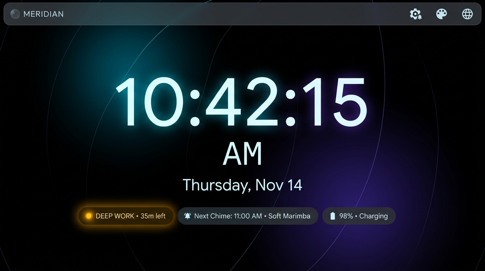
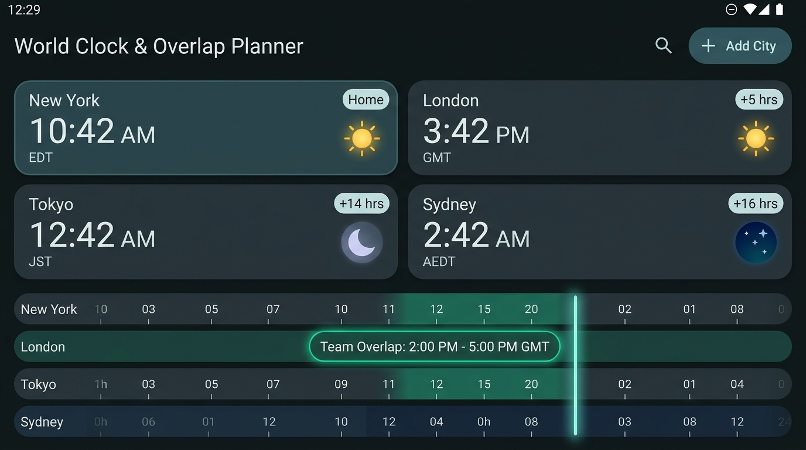
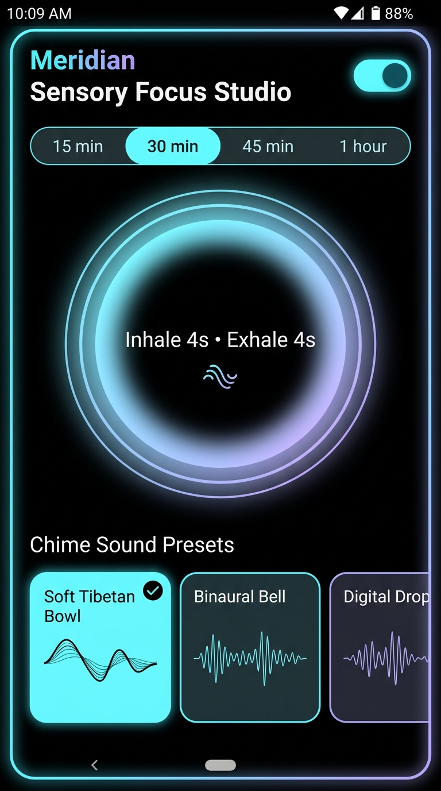
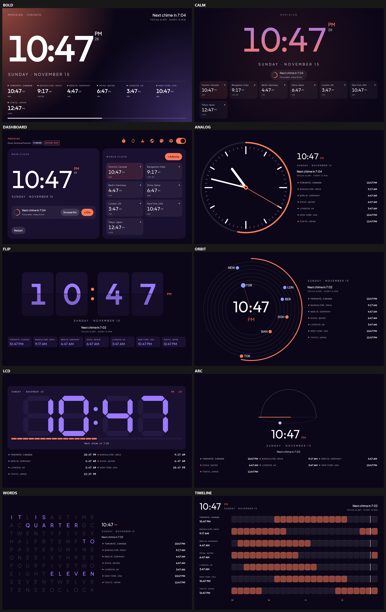
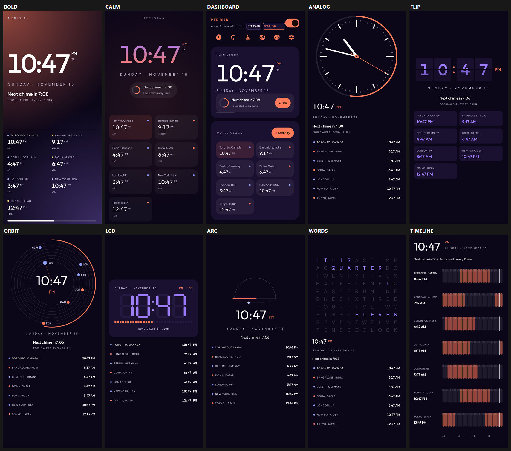

<div align="center">

# ⏱️ Meridian — Android Tab & Mobile Display Always-ON

**An adaptive, full-screen digital wallpaper clock with ADHD-friendly periodic chime reminders and world clock displays.**

[](https://github.com/shobithshetty/Meridian-Android-Tab-Mobile-display-always-ON/releases/latest)
[](https://github.com/shobithshetty/Meridian-Android-Tab-Mobile-display-always-ON/releases/latest)

<br/><br/>



</div>

---

## 📸 App Screenshots

<div align="center">
<table>
  <tr>
    <td align="center"><b>🌍 World Clock & Overlap Planner</b></td>
    <td align="center"><b>🔔 ADHD Chime & Focus Studio</b></td>
  </tr>
  <tr>
    <td></td>
    <td></td>
  </tr>
</table>
</div>

---

## 🎛️ Layouts & Watch Faces

Pick a look in **Settings → Layout Style**. Every layout has the same features (chime controls, world clock, city pin/remove, eye-break countdown, focus sessions, day strip, night dimming); only the design changes.

| Layout | What it is |
|---|---|
| **Bold** (default) | Giant time over a colour wash |
| **Calm** | Quiet, centred, minimal |
| **Dashboard** | Clean cards with everything visible |
| **Classic** | The original outlined layout |
| **Analog** | Round dial with hands; chime countdown as a ring |
| **Flip** | Split-flap desk clock |
| **Orbit** | Each city orbits on its own ring by local time of day |
| **Retro LCD** | Seven-segment display with ghost segments |
| **Day arc** | A sun crossing an arc; the moon at night |
| **Word clock** | The time spelled out in letters |
| **Timeline** | A 24-hour day/night bar per city for planning |

<div align="center">

<br/><br/>

</div>

*Images are generated by the project's layout test, so they show every layout at every screen size.*

---

## 📱 Download & Install

### For Android Users:
1. Tap the green badge above, or open the [Releases page](https://github.com/shobithshetty/Meridian-Android-Tab-Mobile-display-always-ON/releases/latest) and download the newest `Meridian-v*.apk`.
2. Open the downloaded file on your Android tablet or phone.
3. If prompted, allow **"Install unknown apps"** from your browser/files app.
4. Tap **Install** and open Meridian!

---

## ✨ Features

- **🕒 Full-Screen Always-On Display:** Designed for desks, nightstands, and wall-mounted tablets to keep the time visible without screen timeout.
- **🔔 ADHD-Friendly Periodic Chimes:** Gentle, customizable auditory cues (synthesized audio tones) to maintain time awareness and reduce time-blindness.
- **🌍 World Clock & Overlap Planner:** Track multiple timezones simultaneously with city cards and interactive overlap planning.
- **🫁 Paced Breathing Bubble:** Integrated visual breathing guide for mindfulness and stress reduction.
- **🎨 Theme Studio:** Custom color themes (including the new Aurora and Field Gold), typography (Outfit, Plus Jakarta Sans, JetBrains Mono), AMOLED-optimized dark modes, and an optional camo backdrop.
- **🕰️ 11 Layouts & Watch Faces:** From a giant minimal clock to an analog dial, flip clock, orbiting world clocks and a 24-hour timeline, built for phones and tablets in portrait and landscape.
- **⏲️ Focus Sessions:** Start a 15–90 minute focus block from the header; a slim timer shows on every layout and a banner marks completion.
- **📊 Day Strip:** A thin 24-hour bar along the bottom showing the day so far, your alarms and any running focus session.
- **🌙 Night Dimming:** Off, Auto (10pm–6am) or Bedside (always very dark), plus slow burn-in drift for always-on screens.
- **📲 Home Screen & Lock Screen Widgets:** Quick-glance world clock widgets.

---

## 🛠️ Building From Source

**Prerequisites:** Android Studio & JDK 17+

```bash
# Clone the repository
git clone https://github.com/shobithshetty/Meridian-Android-Tab-Mobile-display-always-ON.git

# Navigate to project directory
cd Meridian-Android-Tab-Mobile-display-always-ON

# Build the release APK
./gradlew assembleRelease
```
The compiled APK will be generated at `app/build/outputs/apk/release/app-release.apk`.
